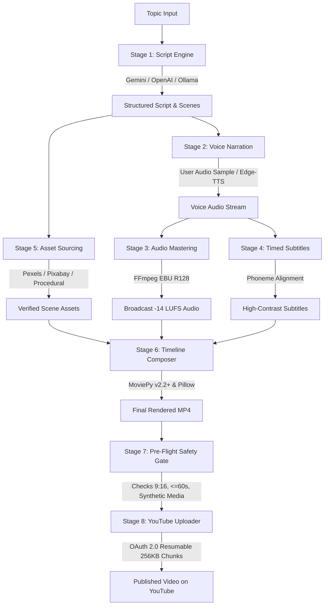

# 🎬 Video Autopilot: Autonomous End-to-End AI Video Pipeline

An enterprise-grade, local-first autonomous video production pipeline designed for YouTube Shorts (9:16) and long-form (16:9) video creation and monetization. 

Give the pipeline a topic, and it executes the complete lifecycle:
**Topic ➔ LLM Scripting ➔ Voice Cloning / Speech ➔ Dynamic Karaoke Subtitles ➔ Asset Sourcing & Vision Verification ➔ -14 LUFS Audio Mastering ➔ MoviePy v2.2+ Composition ➔ Pre-Flight Compliance Gate ➔ YouTube Resumable Upload.**

---

## 🏛️ Pipeline Architecture



---

## 🚀 Key Features

1. **Dual Format Production**:
   - **YouTube Shorts**: Vertical 9:16 (`1080x1920`), punchy hook, rapid scene pacing, strictly $\le$ 60 seconds.
   - **Long-Form Videos**: Horizontal 16:9 (`1920x1080`), progressive chapters, timestamps, and deep-dive narrative.
2. **Mac Apple Silicon (M-Series) Optimized**:
   - Runs natively on Apple Silicon without NVIDIA CUDA dependencies.
   - Uses low-memory fast neural speech engines and native Pillow-backed MoviePy v2 text rendering (no legacy ImageMagick bugs).
3. **Broadcast-Grade Audio Mastering**:
   - Multi-stage dialogue filterchain: 80 Hz high-pass, 3-band parametric EQ (mud cut at 200 Hz, presence at 4.2 kHz), 3:1 compression, peak de-esser, and two-pass EBU R128 loudness targeting **-14 LUFS** and **-1.5 dBTP**.
4. **YouTube Policy & Synthetic Media Compliance**:
   - Automatically sets `status.containsSyntheticMedia: true` during upload to comply with YouTube's Altered & Synthetic Content disclosure policy.
   - Embeds `#Shorts` in titles and descriptions for algorithmic categorization.
5. **Resumable 256 KB Chunk Ingestion**:
   - Implements the official Google Resumable Upload protocol with automatic token refresh (`refresh_token`) and daily quota tracking (default 10 videos/day).

---

## 🛠️ Quick Start

### 1. Installation
```bash
# Clone and enter directory
cd video-autopilot

# Create virtual environment
python3 -m venv .venv
source .venv/bin/activate

# Install dependencies
pip install -r pyproject.toml
```

### 2. Environment Configuration
Copy `.env.example` to `.env`:
```bash
cp .env.example .env
```
Fill in your API keys (optional; the pipeline includes deterministic offline fallbacks for immediate testing):
- `GEMINI_API_KEY`: For script generation and vision verification
- `PEXELS_API_KEY`: For stock video retrieval
- `DAILY_UPLOAD_LIMIT`: Daily limit (default `10`)

### 3. Generate a Video via CLI
```bash
# Generate a YouTube Short
python cli.py generate --topic "Quantum Computing in 2026" --format short

# Generate a Long-form 16:9 video
python cli.py generate --topic "The Future of Space Travel" --format long

# Batch process multiple topics from a JSON file
python cli.py batch --manifest topics.json
```

### 4. REST API & Background Queue
```bash
python server.py
# Server runs at http://localhost:8000
# Interactive Swagger docs: http://localhost:8000/docs
```

---

## 🔑 YouTube Data API v3 Setup Guide

To enable automated posting to your YouTube channel:

1. Open [Google Cloud Console](https://console.cloud.google.com/).
2. Create a new project named `video-autopilot`.
3. Navigate to **APIs & Services ➔ Library** and enable **YouTube Data API v3**.
4. Go to **APIs & Services ➔ OAuth consent screen**:
   - Select **External**.
   - Fill in App Name and your support email.
   - Add scope: `https://www.googleapis.com/auth/youtube.upload`.
   - Add your Gmail account as a **Test User**.
5. Go to **APIs & Services ➔ Credentials**:
   - Click **Create Credentials ➔ OAuth client ID**.
   - Application type: **Desktop app**.
   - Download the JSON file and save it as `client_secrets.json` inside the `video-autopilot/` directory.
6. The first time the pipeline runs with `--upload`, a browser tab will open once asking you to authorize your channel. The credentials will be saved locally to `oauth_credentials.json` and refreshed automatically forever.

---

## 🎙️ Custom Voice Cloning

Your reference voice recording has been placed in:
```
data/voice_samples/default_voice.wav
```
To enable custom cloned voice narration, configure `ELEVENLABS_API_KEY` and `ELEVENLABS_VOICE_ID` in `.env`, or use the built-in neural voice (`en-US-ChristopherNeural`) for zero-cost instant generation.
